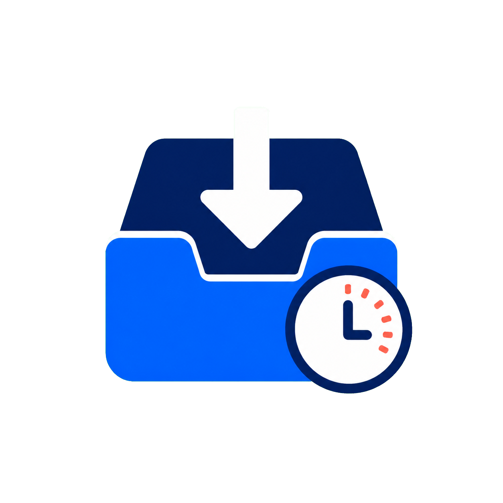

# TempDrop



**TempDrop은 잠깐 쓰고 버릴 파일을 위한 로컬 임시 보관함입니다.** PPT, PDF, 이미지, 압축 파일 등을 전용 폴더에 넣어두면 사용자가 정한 기간 뒤 자동으로 영구삭제합니다.

> [!WARNING]
> 만료된 파일은 휴지통을 거치지 않고 영구삭제되며 TempDrop으로 복구할 수 없습니다. 첫 실행 때 명시적으로 동의해야만 자동 정리가 활성화됩니다.

## 다운로드

[GitHub Releases](https://github.com/jeoungan/TempDrop/releases/latest)에서 최신 버전을 받으세요.

- `TempDrop-<버전>-setup-x64.exe` — 권장 설치 파일
- `TempDrop-<버전>-portable.zip` — 무설치 버전
- `SHA256SUMS.txt` — 다운로드 파일 무결성 확인용 해시

Windows 10 1809 이상 또는 Windows 11에서 동작합니다. 지원되는 Windows에 포함된 .NET Framework를 사용하므로 별도 런타임 설치가 필요 없습니다.

## 사용법

1. TempDrop을 실행하고 전용 관리 폴더를 선택합니다. 기본값은 `%USERPROFILE%\Downloads\TempDrop`입니다.
2. 1~365일 사이에서 기본 보관 기간을 선택합니다.
3. 영구삭제 안내를 읽고 동의합니다.
4. 앱에 파일을 끌어놓거나 `Move files in`으로 옮깁니다. 브라우저 다운로드 위치를 관리 폴더로 직접 지정해도 됩니다.
5. TempDrop이 매일 확인해 보관 기간이 지난 파일을 영구삭제합니다.

앱으로 옮긴 파일은 개별 만료 시각이 기록됩니다. 관리 폴더에 직접 넣은 파일은 생성 시각과 현재 기본 보관 기간을 기준으로 합니다. `.crdownload`, `.part` 같은 다운로드 중 파일은 삭제하지 않습니다.

## 안전 장치와 개인정보

- 텔레메트리, 광고, 분석, 클라우드 전송, 네트워크 요청 없음
- 첫 실행 때 영구삭제 명시적 동의
- 삭제 직전마다 관리 폴더 내부 경로인지 재검사
- 드라이브·사용자 폴더·다운로드·바탕화면·문서·OneDrive 루트와 네트워크 경로 차단
- NTFS 링크 및 재분석 지점을 따라가지 않음
- 다운로드 중 파일 보호
- `%LOCALAPPDATA%\TempDrop\cleanup.log`에 성공한 삭제 기록 저장
- 제거 프로그램은 예약 작업만 해제하고 남은 파일과 설정은 보존

자세한 내용은 [PRIVACY.md](PRIVACY.md)와 [SECURITY.md](SECURITY.md)를 참고하세요.

## 제거

Windows **설정 → 앱 → 설치된 앱 → TempDrop → 제거**를 사용합니다. 앱과 예약 작업은 제거되지만, 실수로 자료가 사라지지 않도록 관리 폴더와 `%LOCALAPPDATA%\TempDrop` 설정은 남겨둡니다.

## 직접 빌드 및 테스트

NuGet 패키지나 제3자 런타임 의존성이 없습니다.

```powershell
powershell.exe -NoProfile -ExecutionPolicy Bypass -File .\scripts\build.ps1
powershell.exe -NoProfile -ExecutionPolicy Bypass -File .\scripts\test.ps1
```

`v1.0.0` 같은 태그를 푸시하면 GitHub Actions가 빌드·테스트·설치 파일·무설치 ZIP·SHA-256 해시·GitHub Release 생성을 자동으로 수행합니다. Windows 코드 서명 연결 방법은 [docs/CODE_SIGNING.md](docs/CODE_SIGNING.md)에 있습니다.

## 라이선스

[MIT](LICENSE)
